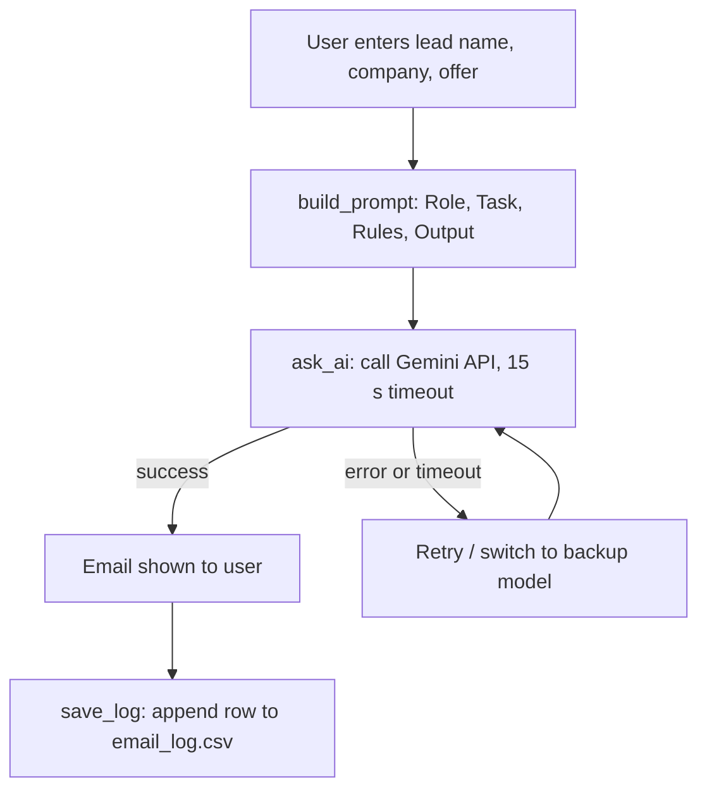

# Cold Email Agent

An AI agent that writes personalised B2B cold emails in seconds. Built for the Parivestra Ventures AI Capability-Building Internship (Agent #03, Sales & Lead Generation).

## 1. The business problem

Writing a good personalised cold email by hand takes about 10 minutes (author's estimate). Sales teams therefore send fewer emails and miss opportunities.

## 2. The solution

The user enters a lead's name, company and the offer. The agent builds a structured prompt, sends it to Google's Gemini model, and returns a ready-to-review email with a subject line. If a model is busy or retired, the agent retries and switches to a backup model. Every run is saved to a CSV file as evidence.

## 3. Measurable outcome

| Metric | Result |
|---|---|
| Leads tested | 10 different businesses |
| Successful runs | 10 of 10 |
| Average time | 4.6 s |
| Fastest / slowest | 0.9 s / 34.3 s |
| Typical time (9 of 10 runs) | about 1.2 s |
| Manual time (estimate) | about 10 minutes per email |

The slowest run (34.3 s) hit a server timeout on both models, then succeeded on the retry. See "Testing" below.

## 4. How it works



This follows the standard agent formula: **Input + Instructions + AI model + Checks, giving a Business output.**

| Part | Where in the code |
|---|---|
| Input | Terminal prompts or the Streamlit form |
| Instructions | `build_prompt()` (role, task, rules, output format) |
| AI model | Gemini via the `google-genai` library |
| Checks | `ask_ai()`: timeout, retries, model fallback; missing-key check |
| Output | Email text plus `email_log.csv` |

## 5. Project structure

```
cold-email-agent/
├── cold_email_agent.py   # the agent: prompt, AI call, retries, logging
├── app.py                # Streamlit web interface
├── test_10_leads.py      # batch test on 10 sample leads
├── email_log.csv         # created automatically: inputs, outputs, timings
├── requirements.txt      # Python libraries
├── .gitignore            # keeps .env and venv out of GitHub
└── README.md
```

The `.env` file (your secret key) and the `venv/` folder are not uploaded to GitHub.

## 6. Setup

**Requirements:** Python 3.10 or higher, a free Gemini API key from [aistudio.google.com](https://aistudio.google.com).

```bash
# 1. Get the code
git clone <your-repository-url>
cd cold-email-agent

# 2. Create and activate a virtual environment (Windows)
python -m venv venv
venv\Scripts\activate

# 3. Install libraries
pip install -r requirements.txt
```

Create a file named `.env` in the project folder with one line (no quotes, no spaces):

```
GEMINI_API_KEY=your_key_here
```

Open `cold_email_agent.py` and set your own signature near the top:

```python
SENDER_NAME = "Your Name"
SENDER_COMPANY = "Your Company"
```

## 7. How to run

**Terminal version:**
```bash
python cold_email_agent.py
```
Type the lead's details, or press Enter to use the sample values.

**Web version:**
```bash
streamlit run app.py
```
Open `http://localhost:8501` in your browser, fill in the form and click **Generate email**.

**Batch test (10 leads):**
```bash
python test_10_leads.py
```

## 8. Sample

**Input:** Lead: Saniya, Rustic Reverie. Offer: an AI agent that answers customer WhatsApp inquiries automatically.

**Output (Gemini, 1.6 s):**

```
Subject: WhatsApp inquiries at Rustic Reverie

Hi Saniya,

Many growing lifestyle brands like Rustic Reverie receive a high volume of
customer questions on WhatsApp about orders, shipping, and products...

Would you be open to a brief, ten-minute chat next Tuesday to see how it works?
```

(Shortened here. Full outputs are saved in `email_log.csv`.)

## 9. Testing

`test_10_leads.py` runs the agent on 10 sample businesses (gym, dental clinic, restaurant, IT firm and others).

- **Result:** 10 of 10 produced an email. Average 4.6 s.
- **A failed first attempt:** an earlier batch run scored 0 of 10 because the computer lost internet access (`getaddrinfo failed`). The agent reported the failures without crashing, and the next run succeeded.
- **Recovered failure:** in one test, both models timed out (timeout and 504), and the retry succeeded after 34.3 s.

"Success" means an email was produced, not that it is perfect. Quality was checked by reading sample emails (length, correct name and company, no invented facts, clear call to action).

## 10. Limitations

- Depends on Google's servers. Speed varies, and 503/504 errors happen.
- The free tier has per-minute and daily limits, so it is not built for thousands of emails.
- The agent does not research the company. It uses only what the user types, so emails can contain general statements rather than verified facts.
- It drafts emails only. It does not send them.
- A human should read every email before sending.
- Model names change over time. If a model is retired, update the `MODELS` list in `cold_email_agent.py`.

## 11. Future improvements

- Add company research from the website (Competitor Research Agent, #06).
- Add a Lead Qualification Agent (#02) that scores leads before an email is written.
- Send emails through Gmail or an email API after human approval.
- Support importing a list of leads from a CSV file.

## 12. Tech stack

| Tool | Purpose | Cost |
|---|---|---|
| Python | Language | Free |
| Gemini API (`google-genai`) | AI model | Free tier with limits |
| `python-dotenv` | Reads the secret key from `.env` | Free |
| Streamlit | Web interface | Free |

## Author

Your Name · Parivestra Ventures AI Capability-Building Internship
